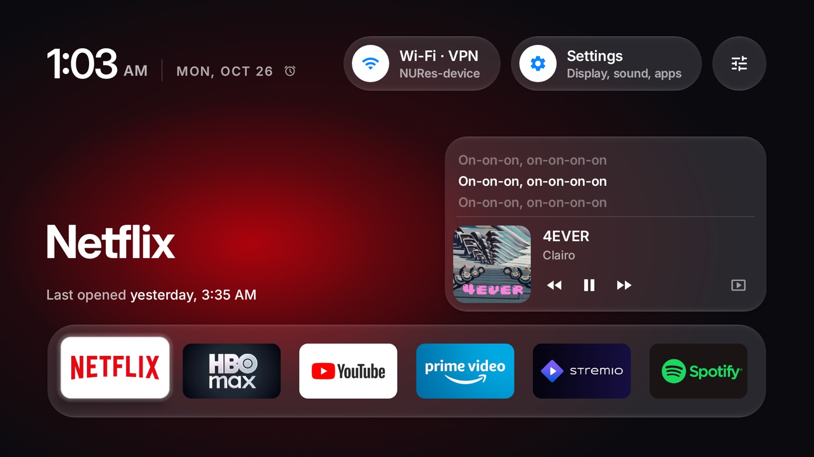
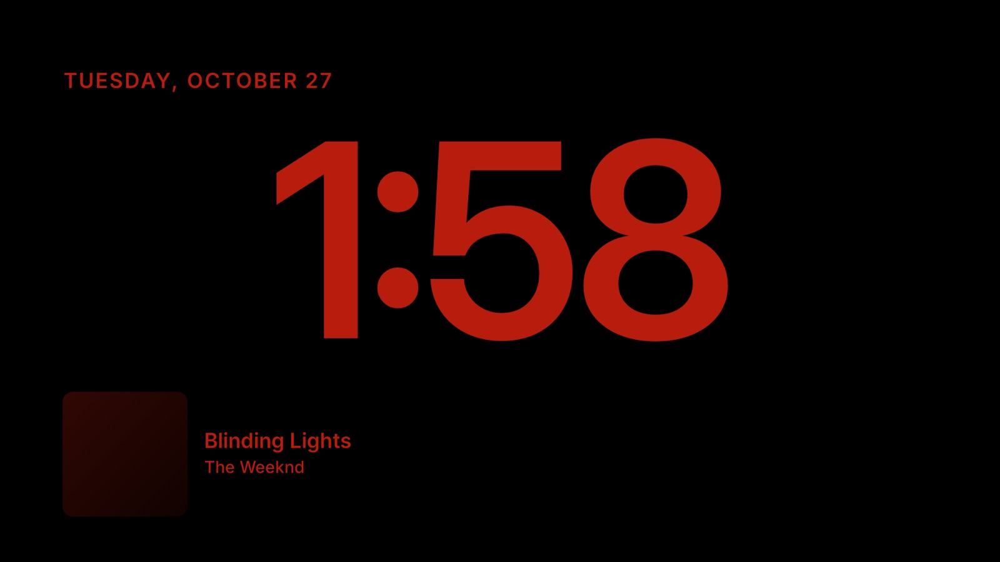
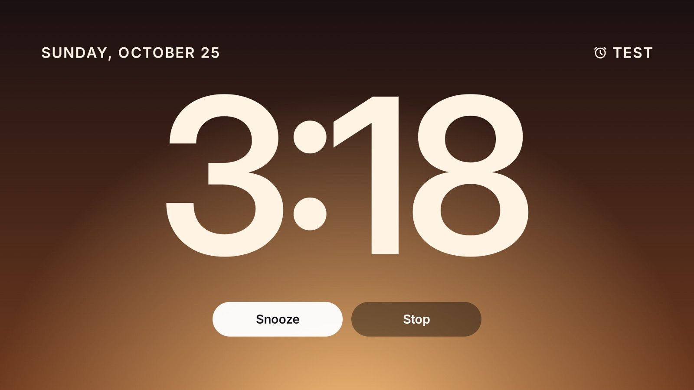

# Glass Home

An Apple TV style home screen for a Fire TV. Glass Home replaces the ad-filled Fire OS home with a
calm launcher built from liquid-glass panels, and adds what I wanted from my own TV: what's playing
(including Spotify on my other devices), synced lyrics, a StandBy-style night clock, and an alarm
that wakes the TV with a sunrise.

It runs on my Hisense 40A4NF (Fire OS 8, Android 11) as a native Android app, with no root and
nothing uninstalled.



| Night Clock | Alarm |
|---|---|
|  |  |

## Features

- **Liquid glass home.** Frosted panels (`GlassMaterial`, `GlassView`) for the top bar, dock and
  Now Playing card. Focus is a white rim, and spacing and type follow a written design system.
- **Now Playing.** Reads the TV's own media sessions and, once linked, Spotify on the account's other
  devices, with a source icon and play/pause/skip from the remote.
- **Synced lyrics.** Line-by-line lyrics from [LRCLIB](https://lrclib.net) in the Now Playing card, and
  a full-screen view with a progress bar on a background drawn from the cover's colours.
- **StandBy screensaver and Night Clock.** A large clock with the playing song's cover. It turns red
  at the dimmest backlight from 22:00 and drifts by whole pixels to protect the panel. An optional
  Screensaver Lyrics switch adds the line being sung beside the song.
- **Alarm and sleep mode.** The alarm wakes the TV from standby into a clock that warms from night red
  to white while the backlight rises, then rings with generated tones. Holding Menu in any app dims
  the picture while the show keeps playing.
- **Small.** Plain Java and the Android SDK, with two AndroidX libraries and nothing else at runtime.

## How it was built

I designed each feature before coding it. Every feature has a written review against Apple's Human
Interface Guidelines for tvOS, kept in [`.design-reviews/`](.design-reviews): the
[design system](.design-reviews/design-system.md), and a decision log per feature (lyrics progress
bar, alarm and sleep, StandBy, paused cover). Early ideas were HTML prototypes in [`mockup/`](mockup).
Later ones were checked on an Android TV emulator set to match the TV (1920×1080 at density 320)
before going onto the real device.

I built it with Claude Code, using two agent skills I wrote for this project:

- **[design-paired-feature](.claude/skills/design-paired-feature/SKILL.md)** pairs a design agent with
  the coding agent for every new feature. The design agent writes the spec before any code, answers
  design questions while the feature is being built, pushes back on weak choices and reviews the result
  from screenshots. Its decision log template is what produced the files in `.design-reviews/`.
- **[tv-preview](.claude/skills/tv-preview/SKILL.md)** makes the Android TV emulator the preview loop:
  install the debug build, drive it with the remote's keys, screenshot it, and only then install on
  the TV.

The design agent grounds its reviews in **[apple-design](.claude/skills/apple-design/SKILL.md)**,
[dickwu/apple-design-skill](https://github.com/dickwu/apple-design-skill) with one change of mine:
its page puller keeps Apple's tvOS guidance, which the original dropped, so TV reviews cite Apple's own
tvOS pages.

## Code map

| Area | Files |
|---|---|
| Home screen | `MainActivity`, `GlassMaterial`, `GlassView`, `DockSlots`, `GridNavigation` |
| Now Playing | `NowPlayingPanel`, `NowPlayingFeed`, `NowPlayingListener`, `SpotifyApi` |
| Lyrics | `LrcLib`, `Lyrics`, `LyricsScreen`, `CoverColours` |
| Clock and StandBy | `ClockActivity`, `ClockDream`, `StandbyScene`, `SleepMode` |
| Alarm | `AlarmActivity`, `AlarmScheduler`, `AlarmSettingsActivity`, `AlarmTones` |
| Settings | `GlassSettings`, `LauncherSettingsActivity`, `Config` |

All in [`launcher/app/src/main/java/io/github/hecbatista/glasshome`](launcher/app/src/main/java/io/github/hecbatista/glasshome),
with unit tests (for example `SpotifyApiTest`) under `launcher/app/src/test`.

## Run it

You need JDK 17, the Android SDK command-line tools and Python 3.

```bash
python3 -m venv tools/venv && tools/venv/bin/pip install -r tools/requirements.txt
```

On the Android TV emulator (Android TV 12, an AVD named `hisense-40`):

```bash
launcher/emu-install.sh
```

On a Fire TV with ADB debugging switched on (Settings → My Fire TV → Developer options):

```bash
TV_HOST=<tv ip> launcher/glass-install.sh
```

The Fire TV's own launcher stays installed. Glass Home takes over the Home button through an
accessibility service, so you can go back by uninstalling the app.

To show Spotify from other devices, create an app at developer.spotify.com and link it. Sign-in uses
PKCE, so there is no client secret:

```bash
launcher/spotify-link.py login --client-id <id>
```

```bash
TV_HOST=<tv ip> launcher/spotify-link.py push
```

## Credits

Glass Home started from the launcher in [CleanYourTV](https://github.com/Gathin23/cleanyourtv) by
Gathin and its contributors (MIT License). The first commit here is their launcher, unchanged, and
everything after it is Glass Home. `tools/tv.py` and `tools/b64push.py` come from the same project.
The Inter font and Material Symbols icons keep their own licenses, in [`launcher/`](launcher).

Lyrics come from [LRCLIB](https://lrclib.net).

## License

MIT. See [LICENSE](LICENSE).
